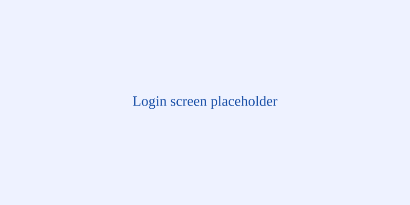
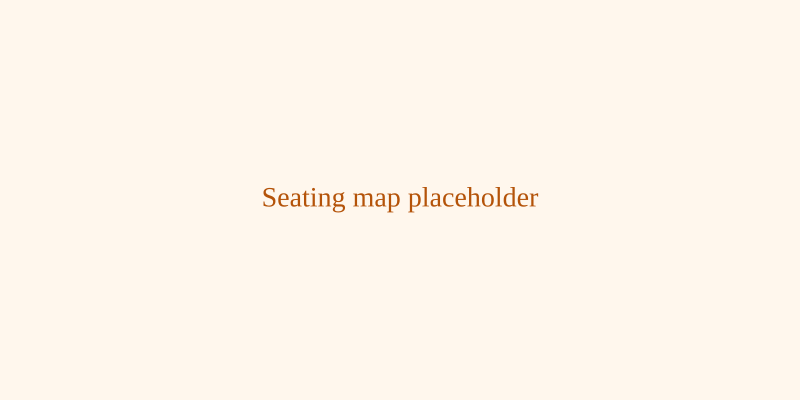
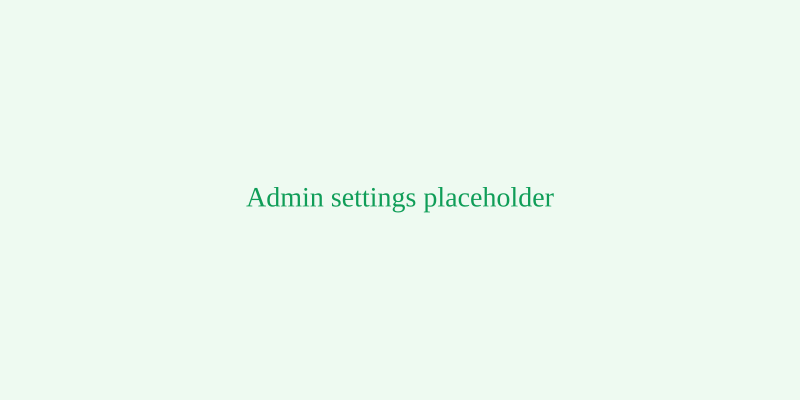

# Call of Protocol

**[PHANERO]** protocol and seating web app. It organizes attendance and seating by hierarchy and runs as a free demo on GitHub Pages, with no installs, no backend and no hosting fees.

**Live demo:** https://YOUR-USERNAME.github.io/call-of-protocol/

## Screenshots

| Login | Seating map | Admin settings |
|---|---|---|
|  |  |  |

## Firebase integration

This starter can optionally use Firebase (Firestore) to store shared data across devices. To enable:

1. Create a Firebase project and Firestore database (follow Firebase docs).
2. In this app, open the Firebase panel and paste your config object (the small JSON with apiKey, projectId, authDomain, etc.).
3. Click "Save & Initialize" — the app will attempt to initialize Firestore and migrate local demo data into the project.

Notes:
- This starter switches only the data layer to Firestore (services, seats, attendees). Authentication remains the local demo accounts unless you implement Firebase Auth.
- Do NOT put production credentials in a public repo. Use environment-specific projects for demos.

## Features

- Hierarchy-based seating, three services, adjustable capacities, live counters, seating map, attendance list, CSV export, print.

## How to deploy

1. Push to GitHub and enable GitHub Pages (Settings → Pages → main branch → root).
2. Optionally paste your Firebase config to use Firestore for shared data.

## Tech

Single-file HTML app. Firebase integration uses the modular Firebase v9 CDN modules when configured.
